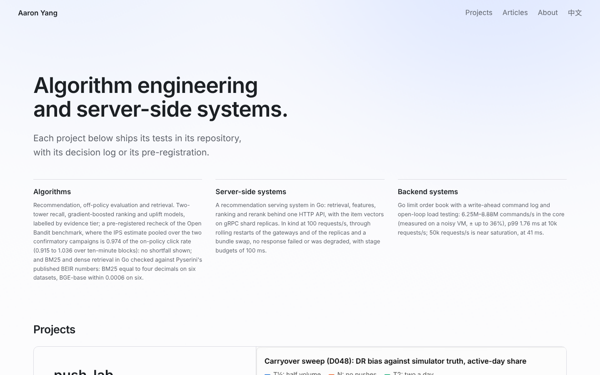
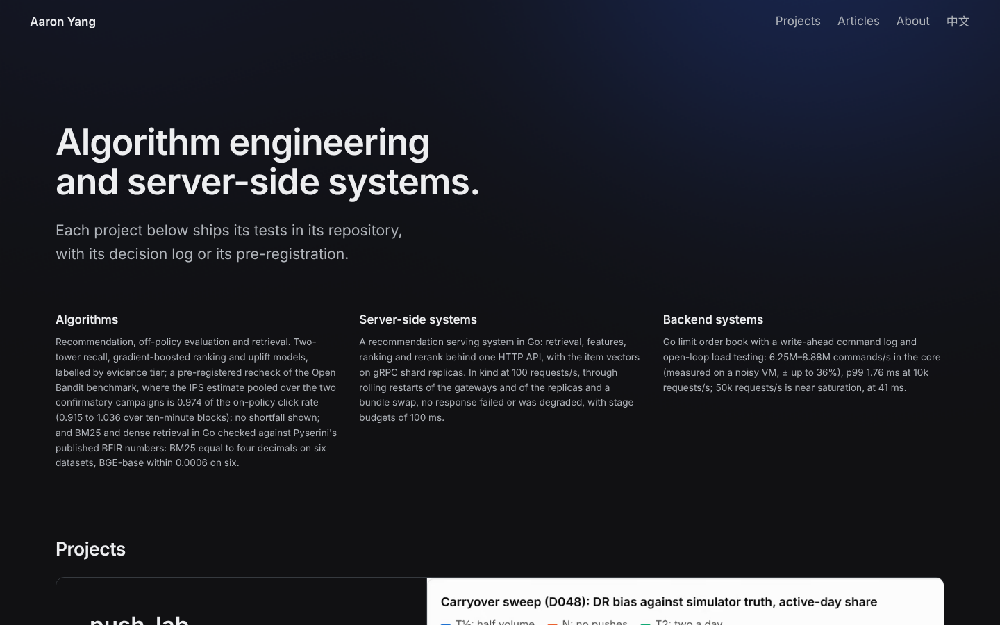
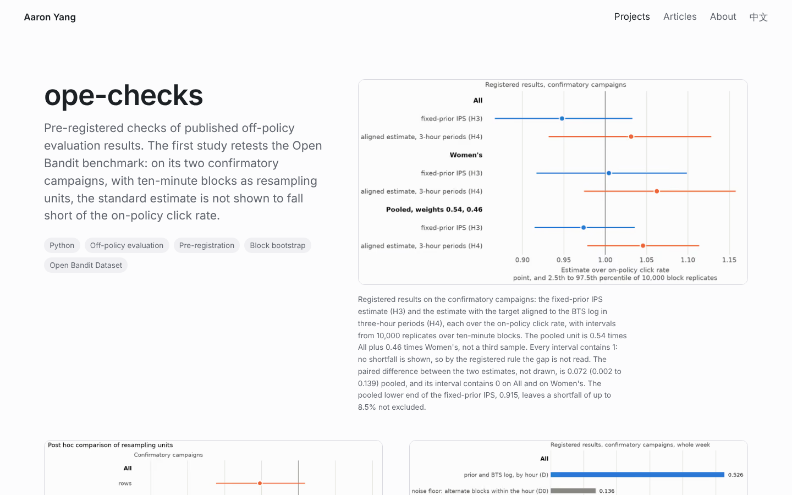
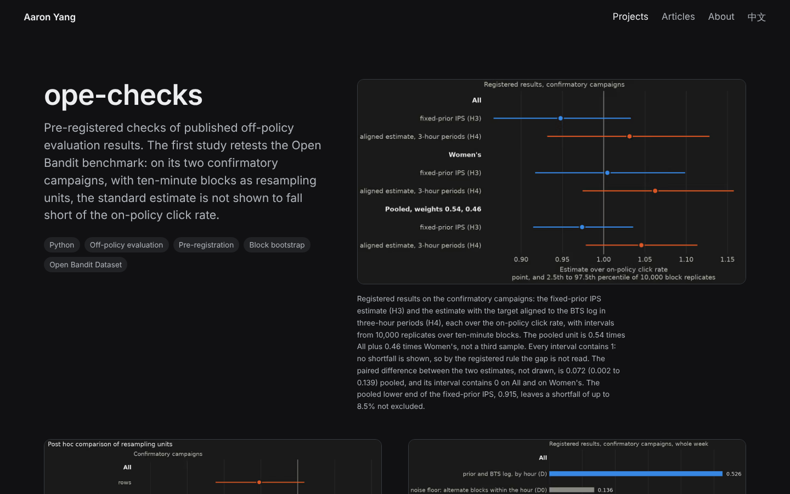

# sHyanorn.github.io

[](https://github.com/sHyanorn/sHyanorn.github.io/actions/workflows/ci.yml?query=branch%3Amain)

Personal website of Aaron Yang, live at [shyanorn.github.io](https://shyanorn.github.io/). Built with Astro and TypeScript, with a hand-written WebGL2 and GLSL background, in English and in Chinese. On the live site at `32a0a9f` on 2026-11-11, Lighthouse scored each of the 32 pages in the table 100 in all four categories on the desktop preset; the lowest mobile medians are 97 for performance and 96 for accessibility. It needs Chrome and Edge 123, Firefox 120 or Safari 17.5 or later, with no fallback below them.

## Results

### Lighthouse

The live site at `32a0a9f` on 2026-11-11, with CI's settings ([D019](docs/DECISIONS.md)): the mobile preset three times per page, the median run kept, and the desktop preset once. Each cell is performance / accessibility / best practices / SEO. Mobile performance on the Chinese pages is the median of seven runs ([D020](docs/DECISIONS.md)).

| Page | Mobile | Desktop |
| --- | --- | --- |
| `/` | 100 / 100 / 100 / 100 | 100 / 100 / 100 / 100 |
| `/zh/` | 99 / 100 / 100 / 100 | 100 / 100 / 100 / 100 |
| `/about/` | 100 / 100 / 100 / 100 | 100 / 100 / 100 / 100 |
| `/zh/about/` | 100 / 100 / 100 / 100 | 100 / 100 / 100 / 100 |
| `/articles/` | 100 / 100 / 100 / 100 | 100 / 100 / 100 / 100 |
| `/zh/articles/` | 100 / 100 / 100 / 100 | 100 / 100 / 100 / 100 |
| `/articles/cryptography-held/` | 100 / 100 / 100 / 100 | 100 / 100 / 100 / 100 |
| `/zh/articles/cryptography-held/` | 100 / 100 / 100 / 100 | 100 / 100 / 100 / 100 |
| `/articles/locking-ends-a-process/` | 100 / 100 / 100 / 100 | 100 / 100 / 100 / 100 |
| `/zh/articles/locking-ends-a-process/` | 100 / 100 / 100 / 100 | 100 / 100 / 100 / 100 |
| `/articles/low-pbo-easy-question/` | 100 / 100 / 100 / 100 | 100 / 100 / 100 / 100 |
| `/zh/articles/low-pbo-easy-question/` | 100 / 100 / 100 / 100 | 100 / 100 / 100 / 100 |
| `/articles/open-bandit-shortfall/` | 100 / 100 / 100 / 100 | 100 / 100 / 100 / 100 |
| `/zh/articles/open-bandit-shortfall/` | 100 / 100 / 100 / 100 | 100 / 100 / 100 / 100 |
| `/articles/order-book-cpu/` | 100 / 100 / 100 / 100 | 100 / 100 / 100 / 100 |
| `/zh/articles/order-book-cpu/` | 100 / 100 / 100 / 100 | 100 / 100 / 100 / 100 |
| `/projects/backtest-lab/` | 100 / 100 / 100 / 100 | 100 / 100 / 100 / 100 |
| `/zh/projects/backtest-lab/` | 99 / 96 / 100 / 100 | 100 / 100 / 100 / 100 |
| `/projects/local-ledger/` | 100 / 100 / 100 / 100 | 100 / 100 / 100 / 100 |
| `/zh/projects/local-ledger/` | 99 / 96 / 100 / 100 | 100 / 100 / 100 / 100 |
| `/projects/matching-engine/` | 100 / 100 / 100 / 100 | 100 / 100 / 100 / 100 |
| `/zh/projects/matching-engine/` | 98 / 100 / 100 / 100 | 100 / 100 / 100 / 100 |
| `/projects/ope-checks/` | 100 / 100 / 100 / 100 | 100 / 100 / 100 / 100 |
| `/zh/projects/ope-checks/` | 99 / 100 / 100 / 100 | 100 / 100 / 100 / 100 |
| `/projects/push-lab/` | 100 / 100 / 100 / 100 | 100 / 100 / 100 / 100 |
| `/zh/projects/push-lab/` | 100 / 96 / 100 / 100 | 100 / 100 / 100 / 100 |
| `/projects/recserve/` | 100 / 100 / 100 / 100 | 100 / 100 / 100 / 100 |
| `/zh/projects/recserve/` | 100 / 100 / 100 / 100 | 100 / 100 / 100 / 100 |
| `/projects/retrieval-lab/` | 100 / 100 / 100 / 100 | 100 / 100 / 100 / 100 |
| `/zh/projects/retrieval-lab/` | 97 / 100 / 100 / 100 | 100 / 100 / 100 / 100 |
| `/projects/vault-share/` | 100 / 100 / 100 / 100 | 100 / 100 / 100 / 100 |
| `/zh/projects/vault-share/` | 97 / 100 / 100 / 100 | 100 / 100 / 100 / 100 |

### Screenshots

At 1440×900 ([D019](docs/DECISIONS.md)).

| Light | Dark |
| --- | --- |
|  |  |
|  |  |

## How it works

- Home: a headline, a one-sentence introduction and the three areas of the work over the WebGL2 background, then the projects as picture cards and the earlier projects as text entries ([D015](docs/DECISIONS.md), [D017](docs/DECISIONS.md), [D020](docs/DECISIONS.md), [D022](docs/DECISIONS.md)).
- `/projects/<slug>/`: one page per project, from `src/content/projects/<slug>.json` ([D012](docs/DECISIONS.md), [D013](docs/DECISIONS.md)). Each project's numbers are traced to its repository in `docs/project-sources/<slug>.md`.
- `/articles/` and `/articles/<slug>/`: articles about the projects, in MDX, each labelled a note or a paper, and the full-text feed at `/rss.xml` ([D005](docs/DECISIONS.md), [D016](docs/DECISIONS.md), [D022](docs/DECISIONS.md)).
- `/about/`: the three areas with what each project built and measured, the earlier projects, and the tools, from `src/content/site/about.json` ([D017](docs/DECISIONS.md)). Each statement is traced in `docs/project-sources/about.md`.

Every page but the 404 page also exists in Chinese under `/zh/` ([D011](docs/DECISIONS.md)). The layout widths are in [docs/SPEC.md](docs/SPEC.md#3-technical-approach) and [D020](docs/DECISIONS.md).

## Run it

Requires Node.js 22.23.4 or later.

```bash
npm install
npm run dev                            # http://localhost:4321
npm run build && npm run preview
npm test                               # unit tests
npm run lint && npm run typecheck && npm run format:check
npm run budget                         # JS each page loads, gzipped; limit 150 kB
npm run e2e                            # axe, overflow, links and keyboard, on the built site
npm run screenshots && npm run audit   # screenshots, then the overflow and axe table
node scripts/copy-export.ts <project>…  # a project's text, one file per language, in artifacts/
node scripts/site-image.ts             # after a build: the site's share images, when the home introduction changes
```

`SITE_URL` and `BASE_PATH` set the origin and base path ([D007](docs/DECISIONS.md)); local builds serve from the root. The Deploy workflow runs by hand ([D009](docs/DECISIONS.md)), and `node scripts/check-live.mjs <site URL>` then checks the live site. [docs/SPEC.md](docs/SPEC.md#3-technical-approach) has the screenshot options, the base-path check and what the live check covers.

## Limits

- Browsers: Chrome and Edge 123, Firefox 120 and Safari 17.5, desktop and iOS, or later, set by `light-dark()`, which like `color-mix()`, `svh`, `lh` and AVIF images has no fallback.
- Without scroll-driven animations (Chrome before 115, Firefox before 159, Safari before 26) the first screen fades in on load and blocks further down show at once ([D014](docs/DECISIONS.md)).
- Single Lighthouse runs of one Chinese page ranged from 85 to 100 in mobile performance: on the live site their longest layout task runs after first contentful paint and counts as blocking time ([D020](docs/DECISIONS.md)).
- Where accessibility is below 100, the contrast check read the gallery captions of three Chinese project pages partway through their entrance fade, on mobile.

## Licence

MIT for code. Written content and images are all rights reserved.
